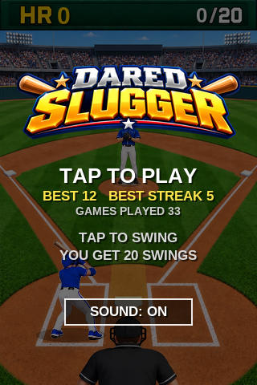
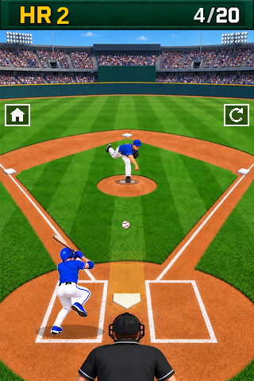
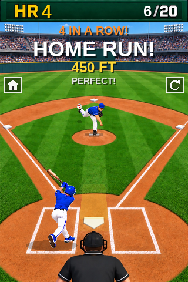

# Dared Slugger

A small OpenGL ES 1.1 baseball game for iPhone OS 2.0 and later. A pitcher
throws, you tap the screen to swing, and you see how many home runs you can hit
in 20 swings.

<p>
  
  
  
</p>

It was written for [iDared 32bit](https://idared32bit-emu.com/) and
[touchHLE](https://touchhle.org/).

## How it plays

Tap to start. The pitcher winds up and throws, and each pitch has a slightly
different speed. The yellow zone over home plate is where the ball can be hit.
Tap while the ball is in it to swing:

| Timing | Home run chance | Distance |
|---|---|---|
| Perfect: the ball crosses home plate | 100% | 400-450 ft |
| Slightly early or late: the brighter band in the zone | 50% | 375-405 ft |
| Anywhere else in the zone | 10% | 340-375 ft |

A home run shows how far it went, and flies into the stands: the further it
goes, the higher and deeper it lands. Home runs in a row are called out: BACK TO
BACK!, then 3 IN A ROW! and so on, until a miss. The game over screen shows your
longest streak, and your best streak ever is saved and shown on the title
screen.

Anything else is a miss. A miss you hit lands on the outfield grass half the
time, and otherwise goes foul. Every pitch uses up one of your 20 swings,
whether you swing at it or not, and after the last one the game is over; tap
to play again.
During a game, the home button (a house), on the left below the outfield wall,
goes back to the title screen, and the restart button (a circular arrow) on the
right starts a new game.
If you hit any home runs, fireworks go off, and keep going for a new best. A
home run with every swing is a PERFECT GAME!, with twice the fireworks, and
your perfect games are counted on the title screen.
The scoreboard shows your home runs and how many swings you've used. Your best,
the most home runs in one game, and the number of games you've played are saved
between launches and shown on the title screen.

Everything is drawn with OpenGL ES 1.1. The field, with the scoreboard, is a
picture (the batter, the pitcher, the ball and the numbers are drawn over it),
stored as raw 8-bit RGB pixels in `resources/field.rgb` (320x480, top row
first), and so is the logo on the title screen, as RGBA in
`resources/logo.rgba` (288x96). The pitcher is 7 pictures of the pitch, from
standing to the follow through, as RGBA in `resources/pitcher.rgba` (512x384,
in 128x192 cells, 4 to a row), and the batter is 7 pictures of the swing, from
the stance to the follow through, in `resources/batter.rgba` (1024x704, in
256x352 cells). The text is drawn by UIKit in the bold system
font (Liberation Sans Bold in touchHLE) and shown as textures.

The pictures (the field, the pitcher, the batter, the app icon and the title
screen logo) are AI generated.

The sound effects in `resources/` (the pitch, the swing, the crack of the bat,
the pop of a home run, the catcher's mitt and the crowd) were generated for this
game and are under the same license as the code. Sound plays through OpenAL. The
SOUND button on the title screen turns it on or off, and that's saved between
launches too.

## Building

You need:

- `clang`, with ARM support.
- The [common-3.0 SDK](https://github.com/touchHLE/common-3.0-sdk): download a
  release and extract it.

Then:

```
make SDK=/path/to/common-3.0.sdk
```

This builds `build/DaredSlugger.ipa`, for armv6 and armv7. Put it in the
`touchHLE_apps` folder of iDared 32bit or touchHLE, and it shows up in the app
picker.

The game doesn't use any SDK headers: the few system APIs it needs are declared
in `src/System.h`.

## License

[Mozilla Public License 2.0](LICENSE).
